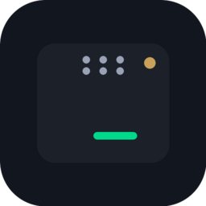

# OMD — a native Rust desktop client for DeepSeek Harness (dsh)

**English** | [中文](README.md)



OMD is a GPU-rendered desktop app for [DeepSeek Harness](https://github.com/deepseek-ai/deepseek-harness) (`@deepseek-ai/dsh`),
written in Rust with [GPUI](https://github.com/zed-industries/zed) — the same stack as the Zed editor and
[herdr](https://github.com/xiaolikt/herdr). The dsh engine (Node) keeps running headless as a child process;
**the UI layer contains no Node and no web view** (the one exception is the optional built-in browser block, which
embeds CEF on purpose).

<br clear="left">

```
┌──────────────────────────────────────────────────────────────────────┐
│ space ▸ tabs ▸ blocks                                                │
│  ┌───────────┬────────────────────────────────┬──────────────────┐   │
│  │ files     │ chat (streaming, approvals)    │ terminal / editor│   │
│  │ tree      │ markdown · tools · images      │ / browser / dsh  │   │
│  └───────────┴────────────────────────────────┴──────────────────┘   │
└──────────────────────────────────────────────────────────────────────┘
   GPUI window  ⇄  Rust worker  ⇄  Typert gateway (HTTP + WS)  ⇄  dsh engine
```

## Why this exists

dsh's official front end is *just a renderer* on top of a structured RPC surface
(a Typert gateway — 144 endpoints across 29 packages, each with JSON Schema).
Reimplementing that RPC surface in Rust gives a native client **100% of the functionality**
without shipping Chromium or Node into the UI:

- **Native rendering** — text, markdown, diffs, tables and terminals are drawn by GPUI on the GPU.
- **Real terminals** — dsh exposes actual PTYs (`terminal/attach`), rendered through
  `libghostty-vt` and painted cell-by-cell, not a web terminal emulator.
- **Native input, IME and clipboard**, first-frame paint in the low milliseconds,
  and no per-keystroke IPC to a browser process.
- **Everything is still the real thing** — sessions, tools, approvals, goals, plugins,
  the market, subagents: all of it goes through the same gateway the web UI uses.

The exported contract lives in [`contracts/endpoints.json`](contracts/endpoints.json)
(29 packages / 144 endpoints, generated from the dsh packages).

## What works today

Verified end-to-end against a real dsh engine (see [README.md](README.md) for the
exhaustive, per-feature verification log):

| Area | Details |
|---|---|
| **Sessions** | `session/list`, `session/create`, `session/follow` (baseline + records + live events + `assistant-stream` deltas), `session/cancel`, `session/fork` (also *fork from a specific message* via `atSeq`), `session/page` paging for long histories |
| **Streaming chat** | Typewriter reveal, markdown (tables, code blocks with copy/actions), inline images pulled via `session/attachment`, reasoning filtering |
| **Approvals & questions** | Waterfall approval cards (`$events/result`), permission presets (`read-only` / `workspace-write` / `danger-full-access`), an "always: preset" one-click allow, agent questions |
| **Terminals** | `terminal/create` + `attach`, PTY write/resize, SGR colors, Kitty graphics for pasted images, `Ctrl+F` scrollback search, mouse selection with copy-on-release, bracketed paste |
| **Layout** | Three levels — space ▸ tab ▸ block. Split a block right/down, drag dividers, maximize, drag-reorder tabs, overflow-scroll tab strip, a space may legitimately have **zero tabs** (empty state with `dsh` / `terminal` entry points) |
| **Block headers** | Notion-style: the header is empty until the pointer enters, then a hairline appears at the top center and expands into a `⠿` grip — drag to move, click for the menu (split right/down × chat/terminal/browser, format, outline, maximize, close) |
| **Editor** | Files sidebar, tree-sitter editor, LSP (completion with auto-import, hover, go-to-definition, code actions, semantic highlighting, diagnostics), `documentSymbol` outline, `textDocument/formatting` |
| **Built-in browser** | A CEF block with its own nav stack per instance, URL bar with history suggestions, element-pick annotation that feeds the chat |
| **Plugins** | `pluginManager/*` (enable/disable), bundles (on-demand install/remove, cancellable, build-script approval), `pluginMarket/*` search with `nextOffset` paging |
| **Workspace** | Goals (`goals/get` banner: objective, phase, rounds, pause/resume/complete/clear with CAS revisions), schedules (`schedule/catalog` + inline edit + delivery history), subagent tree (`parentSessionId`, DFS), background jobs |
| **Persistence & restore** | Layout, tabs, terminals, approvals and workspace state survive a restart; orphan terminals are re-attached by sweeping `terminal/list`; dead PTYs get an in-place restart button |
| **Packaging** | `amd64` `.deb` (~150 MB, bundles CEF + `libghostty-vt`), plus a cross-compiled `omd.exe` |

## Architecture

```
crates/
├── host/       # spawn the dsh child process, parse the token URL, exchange it for a cookie
├── transport/  # Typert Remote: unary (POST /api/<endpoint>) + WS mux (open/item/end/error)
├── spike/      # M0 verification CLI: --list-only / --events N / --follow N / --prompt "..."
└── app/        # GPUI window: spaces, tabs, blocks, terminal, editor, browser, modals
```

- **Engine**: `dsh` runs as a headless child process (`--profile web --no-open --port 0`) in its own
  process group, and is torn down with SIGTERM on exit — no orphaned hosts.
- **Transport**: unary calls over `POST /api/<endpoint>` with the session cookie; streaming
  endpoints (follow, terminal, jobs, `session/control`) share one WebSocket multiplexer.
- **State**: one Rust worker thread owns the RPC client and translates gateway frames into UI
  events; the UI never blocks on the network.
- **Terminal**: PTY bytes → `libghostty-vt` (Zig, built from the official `vt-1.0.0` source) →
  render-state dirty lines → GPUI text runs. Bindings live in `crates/app/src/ghostty_vt.rs`.
- **Browser**: CEF runs out-of-process; frames arrive as BGRA pixels (OSR) and are uploaded into a
  pooled GPUI texture. Native X11 child windows are available with `OMD_BROWSER_CHILD=1`.

## Quick start

```sh
# dsh must be installed globally, or point DSH_BIN at the npx-cached bin.js
DSH_BIN=$HOME/.npm/_npx/1e7f6d9597241db0/node_modules/@deepseek-ai/dsh/lib/bin.js \
  CEF_PATH="$PWD/vendor/cef" \
  LD_LIBRARY_PATH="$PWD/vendor/libghostty-vt/lib" \
  cargo run -p omd
```

Build dependencies (Debian/Ubuntu):

```sh
sudo apt install -y libfontconfig1-dev libfreetype-dev libwayland-dev \
  libxkbcommon-dev libxkbcommon-x11-dev libx11-dev libxcb1-dev \
  libxcb-render0-dev libxcb-shape0-dev libxcb-xfixes0-dev
```

Two heavyweight dependencies are vendored, not committed as binaries:

- `vendor/cef/<version>/cef_linux_x86_64/` — CEF binaries (only needed for the browser block).
- `vendor/libghostty-vt/` — built from the official `libghostty-vt-1.0.0` tarball with Zig 0.17
  (build steps in [README.md](README.md#libghostty-vt终端引擎)).

Also bump inotify limits if dsh's HMR watches the profile directory:

```sh
sudo sysctl fs.inotify.max_user_instances=512
```

### Packaging

```sh
packaging/build-deb.sh   # → packaging/dist/omd_0.1.0_amd64.deb
packaging/test-deb.sh    # unpack and smoke-test without installing
packaging/windows/build.sh  # → packaging/dist/omd-windows.zip (cross-compiled on Linux)
```

The Windows build is **compile-time verified only** (import table checked, 52 `ghostty-vt` symbols
present in the DLL export table); it has not been run on real hardware yet.

## Notes and current limits

- **Single writer per session.** A dsh session accepts exactly one write handle: if the same
  session is open in a browser, `session/prompt` from the GUI fails with `session/writer-held`.
  The GUI therefore creates its own sessions (`session/create`) instead of hijacking existing ones.
- **Browser sandbox.** The embedded CEF runs with the Chromium sandbox disabled today, so the
  browser block is not a security boundary — do not point it at untrusted sites.
- **Wayland**: browser frames are BGRA read-back uploaded to a shared GPUI texture (no DMA-BUF);
  IME, clipboard and popup menus inside the browser are unverified there.
- **Windows**: control socket (`omd block`) and D3D11 shared-texture capture are still missing;
  browser frames go through CPU upload.
- Some panels are display-only where the gateway offers no client-side write endpoint
  (for example, reminders are created by the agent's `schedule_create` tool, not by the UI).

## Documentation

The design notes are currently in Chinese; the endpoint contract and code are the
authoritative reference.

| File | Contents |
|---|---|
| [docs/01-dsh-architecture.md](docs/01-dsh-architecture.md) | dsh layering, four capability surfaces, why the gateway only |
| [docs/02-gateway-protocol.md](docs/02-gateway-protocol.md) | Typert RPC transport/auth/frames/events, endpoint table, capability → endpoint map |
| [docs/03-rust-gui-architecture.md](docs/03-rust-gui-architecture.md) | target architecture, transport, contract codegen, process management, block design |
| [docs/04-terminal-stack.md](docs/04-terminal-stack.md) | herdr's terminal stack (`libghostty-vt`), phased plan |
| [docs/05-images-and-tables.md](docs/05-images-and-tables.md) | three image layers, tern tables/TSP, project trade-offs |
| [docs/06-plugin-management.md](docs/06-plugin-management.md) | plugin install/remove/toggle, market, inventory, supply-chain safety |
| [docs/07-risks-and-roadmap.md](docs/07-risks-and-roadmap.md) | risks, M0–M5 milestones, effort estimates |
| [docs/08-build-on-herdr.md](docs/08-build-on-herdr.md) | why v1 does not embed herdr-core |
| [docs/09-mobile.md](docs/09-mobile.md) | mobile feasibility assessment |
| [docs/10-startup-timings.md](docs/10-startup-timings.md) | measured startup: first frame ~110 ms, GPU wake-up pitfalls, fontconfig narrowing |
| [docs/20-editor-lsp.md](docs/20-editor-lsp.md) | editor and LSP setup |
| [contracts/endpoints.json](contracts/endpoints.json) | 29 packages / 144 endpoints with request/response JSON Schema |

## Status

M0–M2 are complete; M3 is in progress (files/editor, plugin management and market, message
feedback, session fork/pin/archive, slash-command palette, attachments, goal banner, schedules,
workspace state stream, subagent panel, terminal search/scrollback, long-session paging,
terminal paste).

Two habits that shaped the design:

1. **Verify against the real engine.** Every capability in the tables above was exercised on a
   live dsh gateway (approval → tool run → file on disk, terminal `echo`, fork at `atSeq`, exact
   formatting edits from rust-analyzer, and so on).
2. **Keep the UI honest about sandboxing.** The client never silently escalates: permission presets
   are visible in the composer and every approval carries its preset.

## License

MIT. dsh itself is MIT; CEF, GPUI and `libghostty-vt` keep their own licenses.
